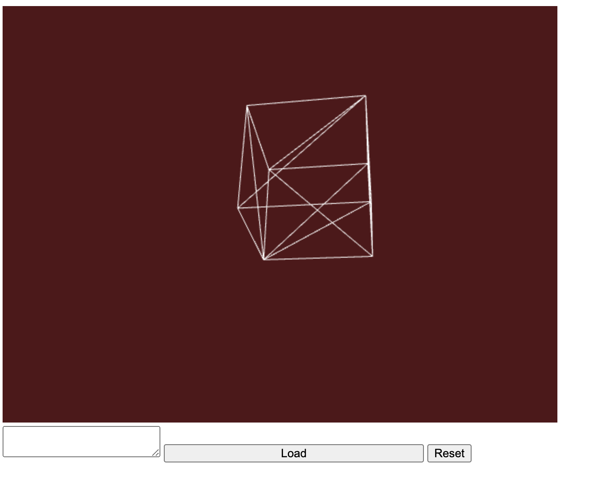

# WebGL based browser OBJ viewer

This is for viewing [OBJ files](https://en.wikipedia.org/wiki/Wavefront_.obj_file) in your browser.


## Status

**Working:**
- WebGL canvas rendering (wireframe cube on dark red background)
- Mouse drag to rotate model
- Mouse scroll to zoom in/out
- Reset Camera button

**Incomplete / not yet implemented:**
- OBJ file loading — the Load button and textarea exist in the UI but are not wired up; no OBJ parser exists
- Only a hardcoded cube model is shown; the app cannot yet load real `.obj` files

**Tech stack:** TypeScript, WebGL 1.0, Vite, gl-matrix

## Prerequisites

All you need to get started is [Node.js](https://nodejs.org/) and [npm](https://www.npmjs.com/get-npm).

## Install

```
git clone https://github.com/gunax/ObjViewer.git .
```

Then install dependencies:
```
npm install
```

## Run

```
npm start
```

Then open browser to [localhost:5173](http://localhost:5173/)

## Build

```
npm run build
```
